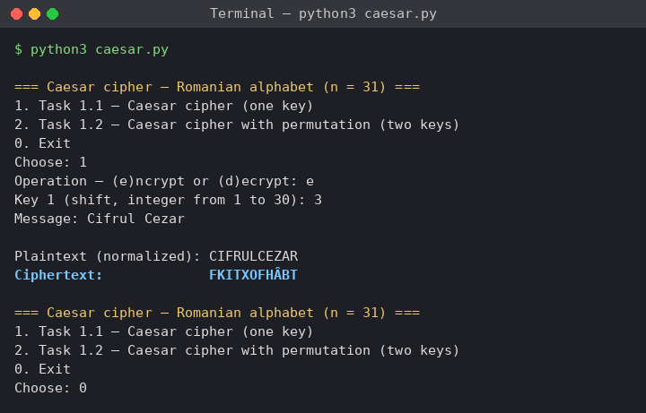
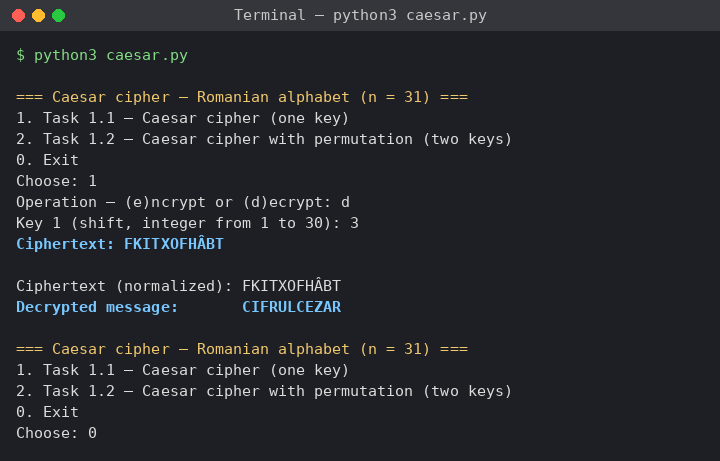
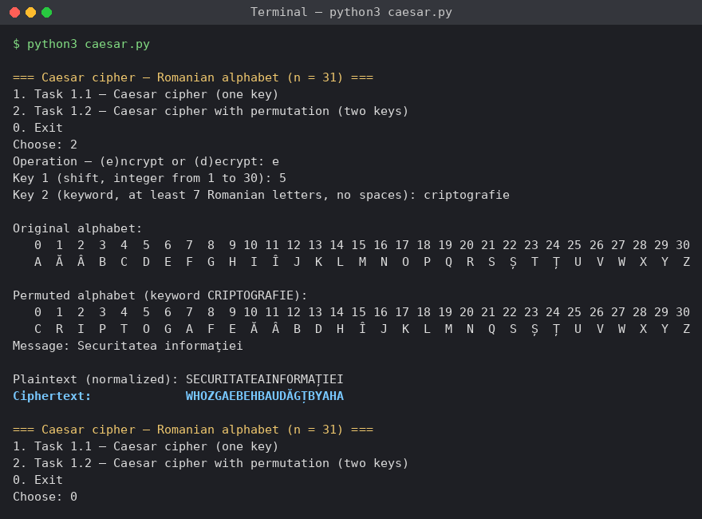
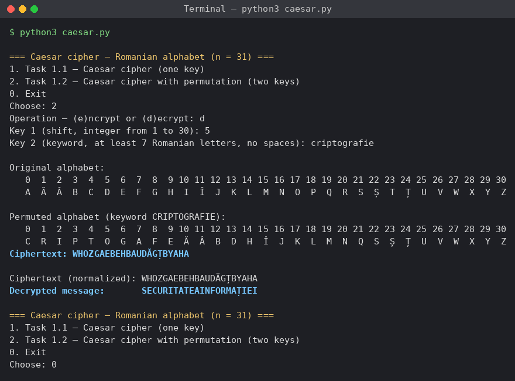
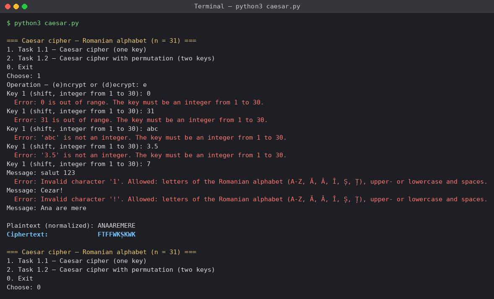
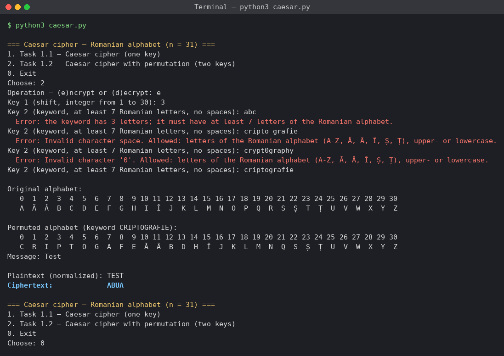

# Report on laboratory work no. 1

**Course:** Cryptography and Security  
**Topic:** The Caesar Cipher and the Caesar Cipher with a Permutation  
**Done by:** st. gr. FAF-243, Buliga Vladislav  
**Checked by:** Zaica Maia, asist. univ.  
Chișinău, 2026

---


## 1 AIM OF THE WORK


### 1.1 Purpose of the laboratory work

The purpose of this laboratory work is to understand how the Caesar cipher works, to see why its small key space makes it insecure, to strengthen it with a keyword-based permutation of the alphabet, and to implement both versions for the Romanian alphabet of 31 letters. The work also shows the limits of this improvement: a much larger key space protects the cipher against exhaustive search, but not against frequency analysis.


### 1.2 Problem statement

**Tasks of the laboratory work:**

- implement the Caesar cipher for the Romanian alphabet (n = 31), using only the letter encoding A = 0, Ă = 1, ..., Z = 30 and not the built-in character codes of the language;
- accept a key between 1 and 30 and a text made only of Romanian letters and spaces, convert the text to uppercase and remove the spaces;
- display a clear message for an invalid key or an invalid character and ask for the value again;
- implement the Caesar cipher with two keys, where key 2 is a keyword of at least 7 Romanian letters that permutes the alphabet, and display the permuted alphabet;
- show encryption and decryption for both versions and the messages for invalid input.

Both tasks are solved in one Python 3 console program, caesar.py, which uses only the standard library. The user chooses the task and the operation from a menu.


## 2 THEORETICAL BACKGROUND


### 2.1 The Caesar Cipher

The Caesar cipher is one of the oldest known ciphers. Every letter of the plaintext is replaced by the letter that is a fixed number of positions further along the alphabet; after the last letter the count continues from the first one. It is a symmetric cipher: the same secret key k, the size of the shift, is used for encryption and for decryption. To compute the shift, every letter is replaced by its position in the alphabet, starting from 0. For the Romanian alphabet the positions go from A = 0 to Z = 30, so the length of the alphabet is n = 31. If x is the code of a plaintext letter and y the code of a ciphertext letter, encryption and decryption are defined by the formulas

c = e_k(x) = (x + k) mod n,  
m = d_k(y) = (y − k) mod n.

Decryption with the key k is the same as encryption with the key n − k, because a shift of k followed by a shift of n − k is a full turn of the alphabet.


### 2.2 Modular Arithmetic

The operation a mod n returns the remainder of dividing a by n. It makes the alphabet behave like a circle, the same way a clock goes from 12 back to 1. For example, with k = 3 the letter Z (30) becomes (30 + 3) mod 31 = 2, which is Â. In decryption the difference y − k can be negative; mathematically the result must still be in the range 0 ... n − 1, so n is added: (2 − 3) mod 31 = −1 + 31 = 30, which is Z again. Some programming languages, such as C, C++ and Java, return a negative remainder for a negative dividend (−1 % 31 = −1), so this case must be handled explicitly. Python's % operator already returns a non-negative result for a positive n.


### 2.3 Key Space and Brute-Force Attack

The key space is the set of all possible keys. For the Caesar cipher the key can only take n − 1 useful values: the key 0 leaves the text unchanged, and a key k ≥ n gives the same result as k mod n. For the Romanian alphabet there are therefore only 30 keys. An attacker who intercepts a ciphertext can simply try all of them (an exhaustive search, or brute-force attack); exactly one key produces readable text in the language of the message. A computer does this instantly, and even by hand it takes only a few minutes.


### 2.4 The Caesar Cipher with a Permutation

To enlarge the key space, the alphabet is first reordered with a second key, a keyword k2. The permuted alphabet is built by writing the letters of the keyword first, keeping only the first occurrence of every letter, followed by the remaining letters of the alphabet in their natural order. For example, the keyword CRIPTOGRAFIE gives C R I P T O G A F E, followed by Ă Â B D H Î J K L M N Q S Ș Ț U V W X Y Z without the letters already used. Repeated letters must be dropped, because every letter must have exactly one position; otherwise decryption would be ambiguous. The Caesar shift with key k1 is then applied using the positions in the permuted alphabet, with the same formulas as before.

The 31 letters can be ordered in 31! ≈ 8.22 × 10^33 ways, and there are 30 shifts, so the number of key pairs (k1, k2) is 31! × 30 ≈ 2.47 × 10^35. Exhaustive search is no longer practical. Two remarks are important. First, different key pairs can give the same substitution, so the number of distinct encryptions cannot exceed 31!. Second, a keyword-based permutation cannot produce every one of the 31! orderings, because the letters after the keyword always stay in their natural order; the real key space is smaller, but still far too large to search.


### 2.5 Frequency Analysis

Both versions are monoalphabetic substitution ciphers: a given plaintext letter is always replaced by the same ciphertext letter. Every language has a characteristic distribution of letter frequencies; in Romanian, letters such as E, A, I, R and N are the most common. Because the substitution is fixed, the same distribution appears in the ciphertext, only with different letters. A cryptanalyst counts the letters of a long enough ciphertext, matches the most frequent ones with the most frequent letters of the language and recovers the rest from partially decrypted words. This attack does not depend on the size of the key space, so the permutation does not protect the cipher against it. Ciphers that resist it, such as the polyalphabetic Vigenère cipher, replace the same letter with different letters at different positions.


## 3 IMPLEMENTATION

The program is written in Python 3 and uses only the standard library (the unicodedata module). All the code is in one file, caesar.py. The same encryption and decryption functions are used for both tasks: they receive the alphabet as a parameter, so Task 1.1 passes the normal alphabet and Task 1.2 passes the permuted one.

*Listing 3.1 – Structure of the project*

```
lab1/
├── caesar.py          both tasks, menu and input validation
├── report.md          this report
└── screenshots/       results of the program
```

The program is run from the lab1 folder with the command below.

*Listing 3.2 – Running the program*

```
python3 caesar.py
```


### 3.1 Letter Encoding

The alphabet is stored as a list in the order of Table 2 of the laboratory work, so the code of a letter is its index in the list. The built-in character codes are not used: in Unicode the letter Ă has the code 258, far from A (65), and a shift computed on these codes would not stay inside the Romanian alphabet.

*Listing 3.3 – The Romanian alphabet and the accepted characters*

```
ALPHABET = ["A", "Ă", "Â", "B", "C", "D", "E", "F", "G", "H", "I",
            "Î", "J", "K", "L", "M", "N", "O", "P", "Q", "R", "S",
            "Ș", "T", "Ț", "U", "V", "W", "X", "Y", "Z"]
N = len(ALPHABET)

CHAR_MAP = {}
for letter in ALPHABET:
    CHAR_MAP[letter] = letter
    CHAR_MAP[letter.lower()] = letter
CHAR_MAP.update({"Ş": "Ș", "ş": "Ș", "Ţ": "Ț", "ţ": "Ț"})
```

CHAR_MAP is a dictionary of every character the program accepts, mapped to the uppercase letter it stands for. It contains the uppercase and lowercase letters, and also the variants of Ș and Ț written with a cedilla (Ş, Ţ), which some keyboards produce instead of the comma below. In this way the conversion to uppercase and the treatment of the cedilla variants are done in one lookup, and any character that is not in the dictionary is invalid.


### 3.2 Validation and Normalization of the Text

*Listing 3.4 – The normalize function*

```
def normalize(text, allow_spaces=True):
    text = unicodedata.normalize("NFC", text)
    result = []
    for ch in text:
        if ch == " " and allow_spaces:
            continue
        if ch not in CHAR_MAP:
            shown = "space" if ch == " " else repr(ch)
            allowed = ALLOWED_TEXT + (" and spaces" if allow_spaces else "")
            raise ValueError(f"Invalid character {shown}. Allowed: {allowed}.")
        result.append(CHAR_MAP[ch])
    return "".join(result)
```

The function checks the text character by character. Spaces are skipped, which removes them; any character that is not a Romanian letter raises an error that names the rejected character and states what is allowed; every valid character is replaced by its uppercase letter. The NFC normalization joins a letter typed as two characters (for example "a" followed by a combining breve) into the single letter Ă, so that it is found in the dictionary. For the keyword the function is called with allow_spaces=False, because spaces are not allowed there.


### 3.3 Encryption and Decryption

*Listing 3.5 – Modulo, encryption and decryption*

```
def mod(a, n):
    r = a % n
    return r + n if r < 0 else r


def encrypt(text, k, alphabet=ALPHABET):
    n = len(alphabet)
    position = {letter: i for i, letter in enumerate(alphabet)}
    return "".join(alphabet[mod(position[ch] + k, n)] for ch in text)


def decrypt(text, k, alphabet=ALPHABET):
    n = len(alphabet)
    position = {letter: i for i, letter in enumerate(alphabet)}
    return "".join(alphabet[mod(position[ch] - k, n)] for ch in text)
```

The mod function always returns a value between 0 and n − 1; the correction for a negative remainder is not needed in Python, but it makes the formula independent of the language. The encrypt function builds the dictionary position, which gives the code of every letter in the given alphabet, and applies the formula c = (x + k) mod n to each letter: position[ch] is the code x, mod(x + k, n) is the new code, and alphabet[...] turns it back into a letter. The decrypt function is identical but subtracts the key. Because the alphabet is a parameter, the same two functions implement both tasks.


### 3.4 Building the Permuted Alphabet

*Listing 3.6 – The build_permuted_alphabet function*

```
def build_permuted_alphabet(keyword, alphabet=ALPHABET):
    permuted = []
    for ch in list(keyword) + alphabet:
        if ch not in permuted:
            permuted.append(ch)
    return permuted
```

The letters of the keyword are placed in front of the whole alphabet, and the loop adds every letter only the first time it appears. This drops the repeated letters of the keyword and the letters of the alphabet that the keyword has already used, so the result always contains each of the 31 letters exactly once. The program prints the original and the permuted alphabet with their positions, so the result can be checked by hand.


### 3.5 Reading the Keys

*Listing 3.7 – Reading and validating the two keys*

```
def read_key():
    while True:
        raw = input("Key 1 (shift, integer from 1 to 30): ").strip()
        try:
            k = int(raw)
        except ValueError:
            print(f"  Error: '{raw}' is not an integer. The key must be an integer from 1 to {N - 1}.")
            continue
        if 1 <= k <= N - 1:
            return k
        print(f"  Error: {k} is out of range. The key must be an integer from 1 to {N - 1}.")


def read_keyword():
    while True:
        raw = input("Key 2 (keyword, at least 7 Romanian letters, no spaces): ").strip()
        try:
            keyword = normalize(raw, allow_spaces=False)
        except ValueError as e:
            print(f"  Error: {e}")
            continue
        if len(keyword) >= 7:
            return keyword
        print(f"  Error: the keyword has {len(keyword)} letters; it must have at least 7 "
              f"letters of the Romanian alphabet.")
```

Every input function repeats the question in a while True loop until a valid value is entered. In read_key, int(raw) raises a ValueError for values such as "abc" or "3.5", which is caught and reported, and the range check accepts only 1 ... 30. The keyword is validated with the same normalize function as the text, converted to uppercase and checked to have at least 7 letters. The message and the ciphertext are read in the same way by read_text, which also rejects an empty text.


### 3.6 The Main Program

The main function shows a menu in a loop: the user chooses the task (1 or 2, or 0 to exit), the operation (encryption or decryption) and key 1. For Task 1.2 the program also reads the keyword, builds the permuted alphabet and prints both alphabets. Finally it reads the message or the ciphertext, prints it in normalized form and prints the result of encrypt or decrypt with the chosen alphabet.


## 4 RESULTS

Task 1.1. The message "Cifrul Cezar" with the key 3 was normalized to CIFRULCEZAR and encrypted as FKITXOFHÂBT (Figure 4.1). It can be checked by hand: C (4) becomes 4 + 3 = 7, which is F; I (10) becomes 13, which is K; Z (30) becomes (30 + 3) mod 31 = 2, which is Â, so the shift wraps around the end of the alphabet. The result differs from the English example of the laboratory work (FLIUXOFHCDU) because the Romanian alphabet has the additional letters Ă, Â, Î, Ș and Ț. Decrypting FKITXOFHÂBT with the same key gives back CIFRULCEZAR (Figure 4.2).



*Figure 4.1 – Task 1.1, encryption of "Cifrul Cezar" with k = 3*



*Figure 4.2 – Task 1.1, decryption of FKITXOFHÂBT with k = 3*

Task 1.2. With k1 = 5 and the keyword CRIPTOGRAFIE, the program built the permuted alphabet C R I P T O G A F E Ă Â B D H Î J K L M N Q S Ș Ț U V W X Y Z. The message "Securitatea informaţiei", typed with a cedilla in ţ, was normalized to SECURITATEAINFORMAȚIEI and encrypted as WHOZGAEBEHBAUDĂGȚBYAHA (Figure 4.3). For example, S has position 22 in the permuted alphabet, and 22 + 5 = 27 gives W; C has position 0 and becomes O, at position 5. Decryption with the same two keys gives back the original text (Figure 4.4).



*Figure 4.3 – Task 1.2, encryption with k1 = 5 and k2 = CRIPTOGRAFIE*



*Figure 4.4 – Task 1.2, decryption with the same keys*

Invalid input. The keys 0 and 31 were rejected as out of range, and "abc" and "3.5" as not integers; each message states the allowed range. The texts "salut 123" and "Cezar!" were rejected, and the message names the first invalid character ('1' and '!'), after which a valid text was accepted (Figure 4.5). For Task 1.2 the keyword "abc" was rejected as too short, "cripto grafie" because of the space and "crypt0graphy" because of the digit 0 (Figure 4.6).



*Figure 4.5 – Invalid key and invalid characters in the text*



*Figure 4.6 – Invalid keywords*

*Table 4.1 – Comparison of the two versions of the cipher*

| Version | Keys | Size of the key space | Weakness |
|---|---|---|---|
| Caesar cipher | k ∈ {1, ..., 30} | 30 | Brute force: try all 30 keys |
| Caesar cipher with a permutation | k1 ∈ {1, ..., 30}, keyword k2 of at least 7 letters | at most 31! × 30 ≈ 2.47 × 10^35 | Frequency analysis: the substitution is still monoalphabetic |


## CONCLUSION

In this laboratory work I implemented the Caesar cipher and the Caesar cipher with a keyword permutation for the Romanian alphabet of 31 letters. Both are the same algorithm: a shift by k positions modulo 31. The only difference is the order in which the letters are numbered, which is why one pair of functions, encrypt and decrypt, with the alphabet as a parameter, solves both tasks.

The classic Caesar cipher is very weak, because it has only 30 keys and can be broken by trying all of them. The keyword permutation increases the key space to at most 31! × 30, which makes exhaustive search impractical. It does not make the cipher secure, however: every letter is still always replaced by the same letter, so the frequencies of the Romanian letters remain visible in the ciphertext and frequency analysis recovers the message without knowing the key. A large key space is necessary for a secure cipher, but it is not sufficient.

I also learned several practical details: why the letters must be encoded with their own table instead of Unicode codes, how the modulo of a negative number differs between programming languages, why repeated letters of the keyword must be removed, and how to accept text typed on different keyboards by treating Ş and Ţ with a cedilla as Ș and Ț and by normalizing the Unicode input.


## SOURCE CODE

The full source code is available in the GitHub repository https://github.com/lbrty-7/cs-2026-BuligaVladislav, on the branch lab1 (folder lab1).


## REFERENCES

1. Laboratory Work No. 1. The Caesar Cipher. Cryptography and Security, FCIM, UTM, 2026.

2. Stallings, W. Cryptography and Network Security: Principles and Practice. 7th ed. Pearson, 2017. Chapter 3 "Classical Encryption Techniques".

3. Singh, S. The Code Book. Fourth Estate, 1999. Chapter 1 "The Cipher of Mary Queen of Scots".

4. Python Software Foundation. unicodedata – Unicode Database. Available at: https://docs.python.org/3/library/unicodedata.html
