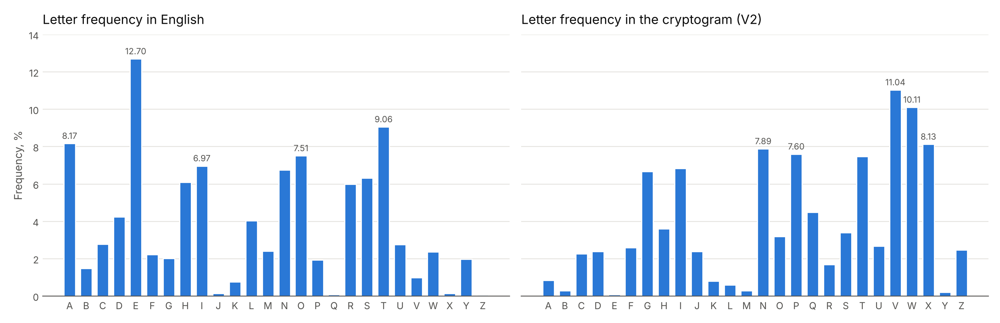
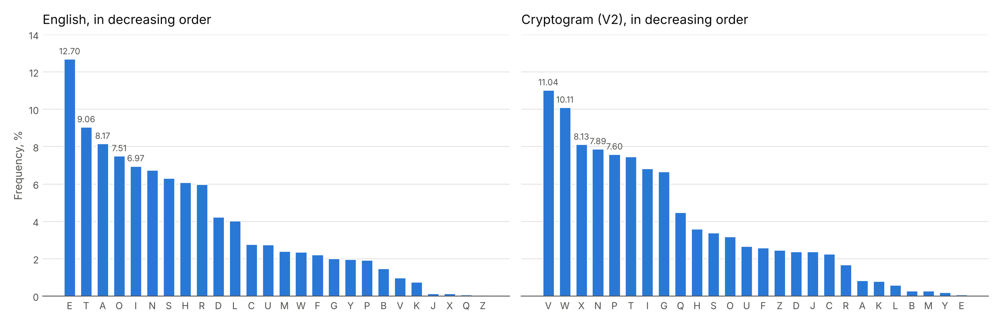
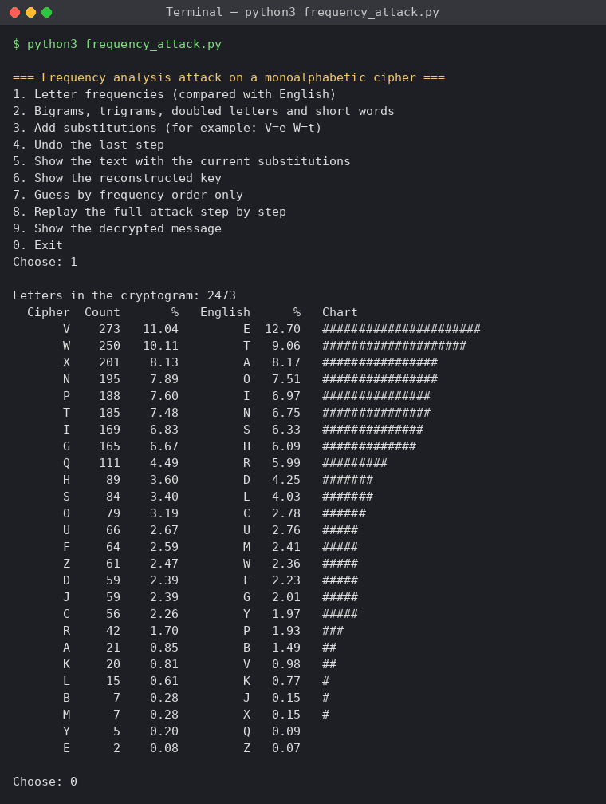
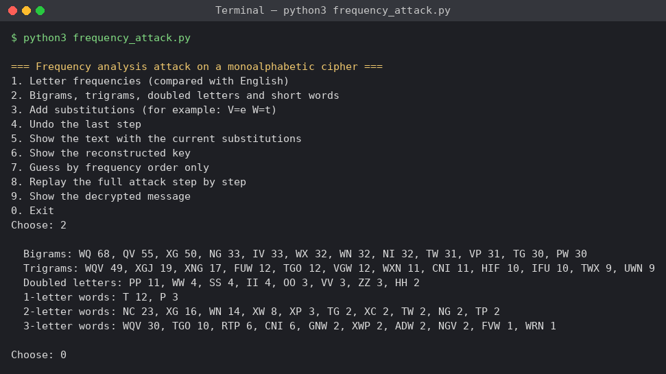
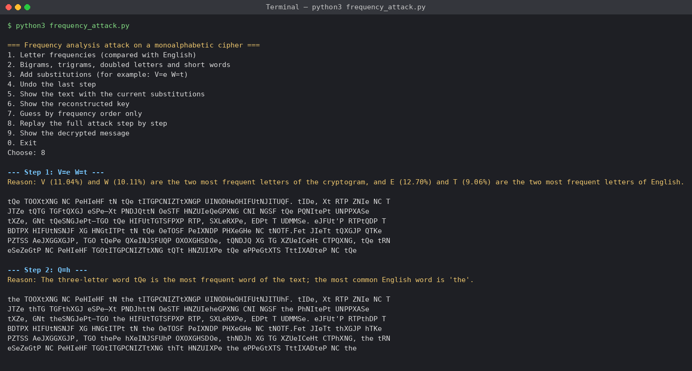
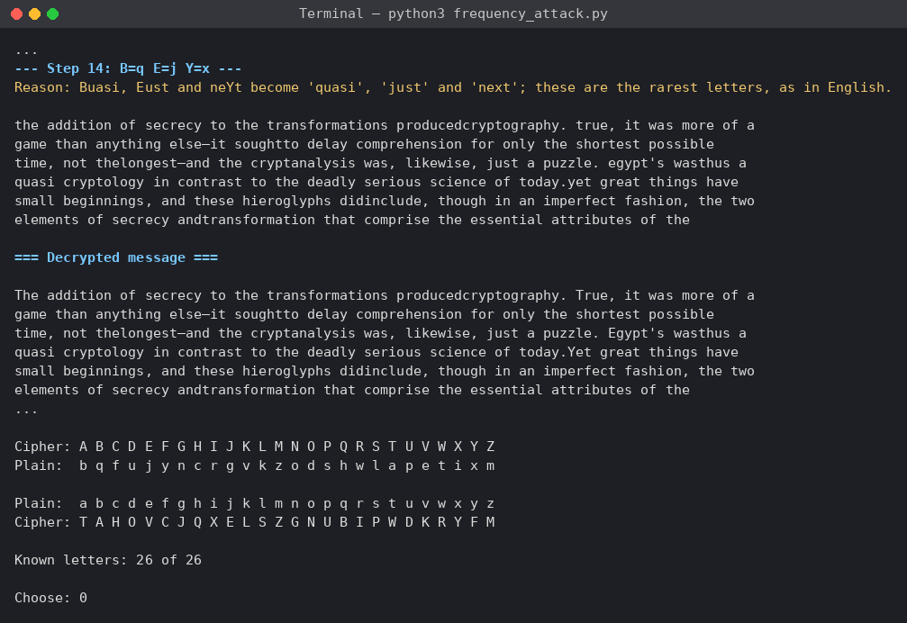
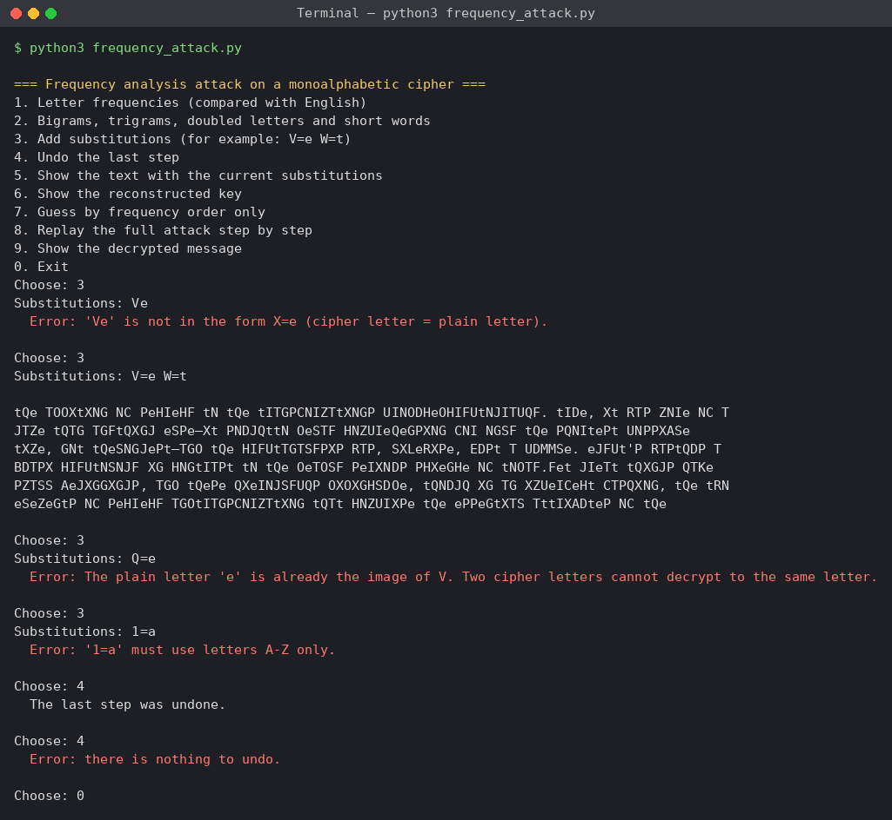

# Report on laboratory work no. 2

**Course:** Cryptography and Security  
**Topic:** Cryptanalysis of Monoalphabetic Ciphers  
**Variant:** 2  
**Done by:** st. gr. FAF-243, Buliga Vladislav  
**Checked by:** Zaica Maia, asist. univ.  
Chișinău, 2026

---


## 1 AIM OF THE WORK


### 1.1 Purpose of the laboratory work

The purpose of this laboratory work is to study the main weakness of monoalphabetic substitution ciphers, the frequency of the letters, and to break such a cipher with a frequency analysis attack. In the first laboratory work the permutation of the alphabet made the key space so large that an exhaustive search was impossible; this work shows that the size of the key space does not help when every letter is always replaced by the same letter, because the statistics of the language stay visible in the ciphertext.


### 1.2 Problem statement

**Tasks of the laboratory work:**

- an encrypted message was intercepted, and it is known that it was obtained with a monoalphabetic cipher;
- assuming that the plaintext is written in English, find the original message by applying the frequency analysis attack;
- only the letters were encrypted, all the other characters (spaces, digits, punctuation) were left unchanged;
- describe the breaking process in the report in the same way as in the example of section 2.3 of the laboratory work.

Each student takes the variant that corresponds to his number in the group list; the author is number 2, so this report solves variant V2. The cryptogram has 34 lines and 2473 letters. The laboratory work suggests the online service of crypto.interactive-maths.com; instead of it, a Python 3 program with the same functions was written: it counts the frequencies, shows the bigrams, trigrams and short words, applies the substitutions chosen by the analyst step by step and rebuilds the key.


## 2 THEORETICAL BACKGROUND


### 2.1 Monoalphabetic Substitution Ciphers

A monoalphabetic substitution cipher replaces every letter of the alphabet with another letter, using one fixed substitution for the whole message. The key is a permutation of the alphabet: for every plaintext letter it says which ciphertext letter replaces it. The Caesar cipher and the Caesar cipher with a keyword from the first laboratory work are special cases of it. For the English alphabet the number of possible keys is 26! ≈ 4.03 × 10^26, so it is impossible to try all of them. The weakness of the cipher is that the substitution never changes: if the letter e is encrypted as V once, every e of the message becomes V. The ciphertext therefore keeps the structure of the language, only with other symbols.


### 2.2 Letter Frequencies of a Language

In every language some letters are used much more often than others. In English the most frequent letters are E (12.70%), T (9.06%), A (8.17%), O (7.51%), I (6.97%) and N (6.75%), and the rarest are J, X, Q and Z, all below 0.2% (table 2.2 of the laboratory work). The longer a text is, the closer its letter frequencies are to these general values. Because the cipher only renames the letters, the frequencies of the ciphertext letters are the frequencies of the plaintext letters they stand for; the most frequent ciphertext letter is most likely e, the second most likely t, and so on.


### 2.3 The Frequency Analysis Attack

The attack was first described by the Arab scholar Al-Kindi around 850 AD. The analyst counts how many times each letter appears in the ciphertext, orders them by frequency and compares this order with the order of the letters in the language. The comparison only gives the first few correspondences with good confidence: the frequencies of a real text are never exactly the general ones, and letters with close frequencies (such as A, O, I and N in English) are easily confused. Simply replacing all the letters in the order of their frequencies almost never gives a readable text.

The analyst then uses other "personality traits" of the letters and words. The most frequent bigrams of English are TH, HE, AN, IN, ER, ON and RE, and the most frequent trigrams are THE, AND, ING, ION and ENT. Only a few letters appear doubled (SS, EE, TT, OO, FF, LL). The only one-letter words are "a" and "I", and the most common short words are "the", "and", "of", "to", "in", "is" and "it". After the first substitutions, partly decrypted words appear (for example "tQe"), and each recognised word gives new letters. The process needs human judgement at every step, which is why it is done interactively and cannot be fully automated by simple counting.


### 2.4 Limits of the Attack and Protection

Frequency analysis needs a long enough ciphertext: for a few words the frequencies are random and the attack fails. It also depends on the known language of the plaintext and on the fact that the word boundaries and punctuation were left in the text, which makes the short words easy to recognise. Writing the ciphertext in groups of five letters, removing the punctuation, or using homophones (several ciphertext symbols for a frequent letter) makes the analysis harder. The real answer is a polyalphabetic cipher, such as the Vigenère cipher, in which the same plaintext letter is encrypted with different letters at different positions, so that the frequencies are flattened.


## 3 IMPLEMENTATION

The program is written in Python 3 and its main part uses only the standard library. The cryptogram of variant V2 is stored in a separate text file, exactly as it is given in the laboratory work. The charts of the report are drawn by a second script with the matplotlib library.

*Listing 3.1 – Structure of the project*

```
lab2/
├── frequency_attack.py   analysis, substitutions, menu, attack steps
├── charts.py             frequency charts (matplotlib)
├── ciphertext_v2.txt     the intercepted cryptogram, variant V2
├── figures/              the charts
├── screenshots/          results of the program
└── report.md             this report
```

The program is run from the lab2 folder with the commands below; the second one is needed only to redraw the charts.

*Listing 3.2 – Running the program*

```
python3 frequency_attack.py
python3 charts.py
```


### 3.1 Counting the Letter Frequencies

*Listing 3.3 – Counting the letters*

```
def letter_counts(text):
    return Counter(ch for ch in text.upper() if ch in LETTERS)


def frequency_table(text):
    counts = letter_counts(text)
    total = sum(counts.values())
    rows = [(letter, counts[letter], 100 * counts[letter] / total) for letter in LETTERS]
    return rows, total
```

The text is converted to uppercase and only the 26 letters are counted, so spaces, digits and punctuation, which were not encrypted, do not change the result. Counter from the collections module counts the occurrences of every letter, and frequency_table turns them into percentages of the total number of letters. The English frequencies of table 2.2 are stored in the dictionary ENGLISH_FREQ, and menu option 1 prints both lists in decreasing order next to each other, with a bar for every letter.


### 3.2 Bigrams, Trigrams and Short Words

*Listing 3.4 – Words and n-grams*

```
def words(text):
    cleaned = "".join(ch if ch in LETTERS else " " for ch in text.upper())
    return cleaned.split()


def ngram_counts(text, n):
    grams = Counter()
    for word in words(text):
        for i in range(len(word) - n + 1):
            grams[word[i:i + n]] += 1
    return grams


def short_words(text, length):
    return Counter(w for w in words(text) if len(w) == length)
```

The function words replaces every character that is not a letter with a space and splits the text into words. The bigrams and trigrams are counted inside the words only, because a pair of letters across a space is not a real bigram of the language. short_words counts the words of a given length, which is the most useful hint for the first steps: the one-, two- and three-letter words of English are few and very frequent. Menu option 2 prints the most frequent bigrams, trigrams, doubled letters and short words.


### 3.3 Applying the Substitutions

*Listing 3.5 – The partial key*

```
def apply_key(text, key):
    result = []
    for ch in text.upper():
        result.append(key[ch].lower() if ch in key else ch)
    return "".join(result)


def add_substitutions(key, pairs):
    new_key = dict(key)
    for cipher, plain in pairs:
        for other, used in new_key.items():
            if used == plain and other != cipher:
                raise ValueError(f"The plain letter '{plain}' is already the image of {other}. "
                                 f"Two cipher letters cannot decrypt to the same letter.")
        new_key[cipher] = plain
    return new_key
```

The key is a dictionary from ciphertext letters to plaintext letters, and it grows during the attack. apply_key follows the convention of the example in the laboratory work: the letters that are already decrypted are written in lowercase and the unknown ones stay in uppercase, so it is easy to see which part of a word is still missing (for example "tQe"). add_substitutions refuses a substitution when the plaintext letter is already the image of another ciphertext letter, because a substitution key is a one-to-one correspondence; two ciphertext letters can never stand for the same plaintext letter. The substitutions are typed as pairs like "V=e W=t", and parse_substitutions checks their format.


### 3.4 The Attack Steps and the Menu

The steps of the attack described in chapter 4 are stored in the list ATTACK_STEPS, each one with the substitutions and the reason for them. Menu option 8 replays them one by one and prints the beginning of the text after every step, so the whole process of chapter 4 can be repeated in the program. The other options allow the same work to be done manually: option 3 adds substitutions, option 4 undoes the last step, option 5 shows the whole text, option 6 shows the reconstructed key in both directions and option 9 prints the decrypted message, with the original uppercase and lowercase letters. Option 7 shows what happens when all the letters are replaced only in the order of their frequencies.

*Listing 3.6 – The first steps of the attack*

```
ATTACK_STEPS = [
    ("V=e W=t",
     "V (11.04%) and W (10.11%) are the two most frequent letters of the cryptogram, "
     "and E (12.70%) and T (9.06%) are the two most frequent letters of English."),
    ("Q=h",
     "The three-letter word tQe is the most frequent word of the text; "
     "the most common English word is 'the'."),
```


## 4 THE BREAKING PROCESS


### 4.1 The Intercepted Cryptogram

The cryptogram of variant V2 is shown below exactly as it is given in the laboratory work, including a few places where the spaces between two words are missing at the end of a line (for example "uinodhvohifuwnjituqf").

*Listing 4.1 – The cryptogram, variant V2*

```
Wqv tooxwxng nc pvhivhf wn wqv witgpcniztwxngp uinodhvohifuwnjituqf. Widv, xw rtp zniv nc t
jtzv wqtg tgfwqxgj vspv—xw pndjqwwn ovstf hnzuivqvgpxng cni ngsf wqv pqniwvpw unppxasv
wxzv, gnw wqvsngjvpw—tgo wqv hifuwtgtsfpxp rtp, sxlvrxpv, edpw t udmmsv. Vjfuw'p rtpwqdp t
bdtpx hifuwnsnjf xg hngwitpw wn wqv ovtosf pvixndp phxvghv nc wnotf.Fvw jivtw wqxgjp qtkv
pztss avjxggxgjp, tgo wqvpv qxvinjsfuqp oxoxghsdov, wqndjq xg tg xzuvicvhw ctpqxng, wqv wrn
vsvzvgwp nc pvhivhf tgowitgpcniztwxng wqtw hnzuixpv wqv vppvgwxts twwixadwvp nc wqv
phxvghv. Tgopn hifuwnsnjf rtp anig. Xg xwp cxipw 3,000 fvtip, xw oxo gnw jinr pwvtoxsf.
Hifuwnsnjf tinpvxgovuvgovgwsf xg ztgf usthvp, tgo xg znpw nc wqvz xw oxvo wqv ovtwqp ncxwp
hxkxsxmtwxngp. Xg nwqvi usthvp, xw pdikxkvo, vzavoovo xg t sxwvitwdiv,tgo cinz wqxp wqv
gvyw jvgvitwxng hndso hsxza wn qxjqvi svkvsp.Adw uinjivpp rtp psnr tgo evilf. Zniv rtp snpw wqtg
ivwtxgvo. Zdhq nc wqvqxpwnif nc hifuwnsnjf nc wqxp wxzv xp t utwhqrnil, t hitmf bdxsw
ncdgivstwvo xwvzp, puindwxgj, csndixpqxgj, rxwqvixgj. Ngsf wnrtio wqvRvpwvig Ivgtxpptghv
onvp wqv thhivwxgj lgnrsvojv avjxg wn adxso du tznzvgwdz. Wqv pwnif nc hifuwnsnjf odixgj
wqvpv fvtip xp, xg nwqvi rniop,vythwsf wqv pwnif nc ztglxgo. Hqxgt, wqv ngsf qxjq hxkxsxmtwxng
nc tgwxbdxwf wn dpv xovnjituqxhrixwxgj, pvvzp gvkvi wn qtkv ovkvsnuvo zdhq ivts hifuwnjituqf
—uviqtup cni wqtw ivtpng. Xg ngv htpv lgnrg cni zxsxwtif udiunpvp, wqv11wq-hvgwdif
hnzuxstwxng, Rd-hqxgj wpdgj-ftn ("Vppvgwxtsp cinz ZxsxwtifHstppxhp"), ivhnzzvgovo t widv xc
pztss hnov. Wn t sxpw nc 40 ustxgwvywxwvzp, itgjxgj cinz ivbdvpwp cni anrp tgo tiinrp wn wqv
ivuniw nc tkxhwnif, wqv hniivpungovgwp rndso tppxjg wqv cxipw 40 xovnjitzp nc tunvz. Wqvg,
rqvg t sxvdwvgtgw rxpqvo, cni vytzusv, wn ivbdvpw znivtiinrp, qv rtp wn Rixwv wqv hniivpungoxgj
xovnjitz tw t puvhxcxvo usthvng tg nioxgtif oxputwhq tgo pwtzu qxp pvts ng xw.Xg Hqxgt'p jivtw
gvxjqani wn wqv rvpw, Xgoxt, rqnpv hxkxsxmtwxngsxlvrxpv ovkvsnuvo vtisf tgo wn qxjq vpwtwv,
pvkvits cnizp nc pvhivwhnzzdgxhtwxngp rviv lgnrg tgo, t Uutivgwsf, uithwxhvo. Wqv Tiwqt-ptpwit,
t hstppxh rnil ng pwtwvhitcw twwixadwvo wn Ltdwxsft, xg ovphixaxgjwqv vpuxngtjv pvikxhv nc
Xgoxt tp uithwxhtssf ixoosxgj wqv hndgwif rxwqp Uxvp, ivhnzzvgovo wqtw wqv nccxhvip nc wqv
xgpwxwdwvp nc £ puxngtjv jxkvwqvxi puxvp wqvxi tppxjgzvgwp af pvhivw rixwxgj.Uviqtup znpw
xgwvivpwxgj wn hifuwnsnjxpwp, tztwvdi niuincvppxngts, xp wqtw Ktwpftftgt'p ctzndp wvywannl
nc vinwxhp, wqv Ltztpdwit,sxpwp pvhivw rixwxgj tp ngv nc wqv 64 tiwp, ni fnjtp, wqtw rnzvgpqndso
lgnr tgo uithwxhv. Wqv cndiwq jivtw hxkxsxmtwxng nc tgwxbdxwf, wqvZvpnun-wtzxtg, itwqvi
utitssvsvo Vjfuw vtisf xg xwp hifuwnjituqxhvknsdwxng, adw wqvg pdiutppvo xw. Wqdp, xg wqv
stpw uvixno nc hdgvxcnizrixwxgj, xg hnsnuqngp rixwwvg tw Didl (xg uivpvgw-otf Xitb) dgovi
wqvPvsvdhxo lxgjp xg wqv stpw cvr phniv fvtip avcniv wqv Hqixpwxtg vit,nhhtpxngts phixavp
hngkviwvo wqvxi gtzvp xgwn gdzavip. Wqvvghxuqvizvgw—xc pdhq xw av—ztf qtkv avvg ngsf cni
tzdpvzvgw ni wnpqnr ncc.
```


### 4.2 Letter Frequencies of the Cryptogram

The first step is to find the frequencies of all the letters that appear in the cryptogram (table 4.1), and to order them in decreasing order (table 4.2). The text has 2473 letters; every letter of the alphabet appears at least once.

*Table 4.1 – Frequency of the letters in the intercepted cryptogram*

| Letter | A | B | C | D | E | F | G | H | I | J | K | L | M |
|---|---|---|---|---|---|---|---|---|---|---|---|---|---|
| Count | 21 | 7 | 56 | 59 | 2 | 64 | 165 | 89 | 169 | 59 | 20 | 15 | 7 |
| % | 0.85 | 0.28 | 2.26 | 2.39 | 0.08 | 2.59 | 6.67 | 3.60 | 6.83 | 2.39 | 0.81 | 0.61 | 0.28 |

| Letter | N | O | P | Q | R | S | T | U | V | W | X | Y | Z |
|---|---|---|---|---|---|---|---|---|---|---|---|---|---|
| Count | 195 | 79 | 188 | 111 | 42 | 84 | 185 | 66 | 273 | 250 | 201 | 5 | 61 |
| % | 7.89 | 3.19 | 7.60 | 4.49 | 1.70 | 3.40 | 7.48 | 2.67 | 11.04 | 10.11 | 8.13 | 0.20 | 2.47 |

*Table 4.2 – Frequency of the letters in the cryptogram, in decreasing order*

| Letter | V | W | X | N | P | T | I | G | Q | H | S | O | U |
|---|---|---|---|---|---|---|---|---|---|---|---|---|---|
| Count | 273 | 250 | 201 | 195 | 188 | 185 | 169 | 165 | 111 | 89 | 84 | 79 | 66 |
| % | 11.04 | 10.11 | 8.13 | 7.89 | 7.60 | 7.48 | 6.83 | 6.67 | 4.49 | 3.60 | 3.40 | 3.19 | 2.67 |

| Letter | F | Z | D | J | C | R | A | K | L | B | M | Y | E |
|---|---|---|---|---|---|---|---|---|---|---|---|---|---|
| Count | 64 | 61 | 59 | 59 | 56 | 42 | 21 | 20 | 15 | 7 | 7 | 5 | 2 |
| % | 2.59 | 2.47 | 2.39 | 2.39 | 2.26 | 1.70 | 0.85 | 0.81 | 0.61 | 0.28 | 0.28 | 0.20 | 0.08 |



*Figure 4.1 – Letter frequencies of English and of the cryptogram*



*Figure 4.2 – Letter frequencies in decreasing order*

The two charts of figure 4.2 have almost the same shape: two high letters, a group of six letters between 6.5% and 8.2%, a step down to 4.5%, and a long tail of rare letters. This confirms that the text is a simple substitution of an English text. The shape gives the groups of letters, but not the exact letter inside a group.


### 4.3 Substitution by Frequency Order Only

As a test, every letter of the cryptogram was replaced by the English letter with the same rank (V by e, W by t, X by a, N by o and so on, menu option 7). The result is not readable:

*Listing 4.2 – The text after a substitution by frequency order only*

```
tre nccataoh oy iedsedm to tre tsnhiyoswntaohi usocfdecdsmutogsnurm. tsfe, at pni wose oy n
gnwe trnh nhmtrahg elie—at iofgrtto celnm dowuserehiaoh yos ohlm tre irosteit uoiiable
tawe, hot trelohgeit—nhc tre dsmutnhnlmiai pni, lakepaie, zfit n ufjjle. egmut'i pnitrfi n
xfnia dsmutologm ah dohtsnit to tre cenclm iesaofi idaehde oy tocnm.met gsent trahgi rnve
iwnll begahhahgi, nhc treie raesoglmuri cacahdlfce, trofgr ah nh awuesyedt yniraoh, tre tpo
```

Only 8 of the 26 letters are correct this way (among them V, W and N, but also some rare letters by chance). As the laboratory work says, the order of the frequencies gives a starting point, and the rest must be found from the words.


### 4.4 Step-by-Step Decryption

**Step 1. V → e, W → t**

The most frequent letter of the cryptogram is V (11.04%), followed closely by W (10.11%); then there is a gap to X (8.13%). In English the two most frequent letters are E (12.70%) and T (9.06%), also separated from the rest, so we assume that V is the image of "e" and W the image of "t". After these substitutions we obtain:

```
tQe TOOXtXNG NC PeHIeHF tN tQe tITGPCNIZTtXNGP UINODHeOHIFUtNJITUQF. tIDe, Xt RTP ZNIe NC T
JTZe tQTG TGFtQXGJ eSPe—Xt PNDJQttN OeSTF HNZUIeQeGPXNG CNI NGSF tQe PQNItePt UNPPXASe
tXZe, GNt tQeSNGJePt—TGO tQe HIFUtTGTSFPXP RTP, SXLeRXPe, EDPt T UDMMSe. eJFUt'P RTPtQDP T
BDTPX HIFUtNSNJF XG HNGtITPt tN tQe OeTOSF PeIXNDP PHXeGHe NC tNOTF.Fet JIeTt tQXGJP QTKe
```

**Step 2. Q → h**

The word "tQe" now appears many times; it is in fact the most frequent word of the cryptogram (WQV, 30 times), and the trigram WQV is also the most frequent trigram (49 times). The most common English word of three letters is "the", which agrees with the substitutions already made, so Q is decrypted as "h":

```
the TOOXtXNG NC PeHIeHF tN the tITGPCNIZTtXNGP UINODHeOHIFUtNJITUhF. tIDe, Xt RTP ZNIe NC T
JTZe thTG TGFthXGJ eSPe—Xt PNDJhttN OeSTF HNZUIeheGPXNG CNI NGSF the PhNItePt UNPPXASe
tXZe, GNt theSNGJePt—TGO the HIFUtTGTSFPXP RTP, SXLeRXPe, EDPt T UDMMSe. eJFUt'P RTPthDP T
BDTPX HIFUtNSNJF XG HNGtITPt tN the OeTOSF PeIXNDP PHXeGHe NC tNOTF.Fet JIeTt thXGJP hTKe
```

**Step 3. T → a**

The letter T appears 12 times as a word on its own ("of T game", "T puzzle", "is T patchwork"). The letter P is also alone 3 times, but only after an apostrophe (eJFUt'P, HhXGT'P), so it is the ending "'s". In English the only one-letter words are "a" and "I", and "I" is always written in uppercase, while in the original text T is always lowercase; T is also frequent (7.48%), close to A (8.17%). Therefore T is "a":

```
the aOOXtXNG NC PeHIeHF tN the tIaGPCNIZatXNGP UINODHeOHIFUtNJIaUhF. tIDe, Xt RaP ZNIe NC a
JaZe thaG aGFthXGJ eSPe—Xt PNDJhttN OeSaF HNZUIeheGPXNG CNI NGSF the PhNItePt UNPPXASe
tXZe, GNt theSNGJePt—aGO the HIFUtaGaSFPXP RaP, SXLeRXPe, EDPt a UDMMSe. eJFUt'P RaPthDP a
BDaPX HIFUtNSNJF XG HNGtIaPt tN the OeaOSF PeIXNDP PHXeGHe NC tNOaF.Fet JIeat thXGJP haKe
```

**Step 4. G → n, O → d**

The word "aGO" is now the most frequent three-letter word after "the" (TGO, 10 times), and TGO is also among the most frequent trigrams. A common three-letter English word that starts with "a" is "and", so G is "n" and O is "d". The word "than" confirms it:

```
the addXtXNn NC PeHIeHF tN the tIanPCNIZatXNnP UINdDHedHIFUtNJIaUhF. tIDe, Xt RaP ZNIe NC a
JaZe than anFthXnJ eSPe—Xt PNDJhttN deSaF HNZUIehenPXNn CNI NnSF the PhNItePt UNPPXASe
tXZe, nNt theSNnJePt—and the HIFUtanaSFPXP RaP, SXLeRXPe, EDPt a UDMMSe. eJFUt'P RaPthDP a
BDaPX HIFUtNSNJF Xn HNntIaPt tN the deadSF PeIXNDP PHXenHe NC tNdaF.Fet JIeat thXnJP haKe
```

**Step 5. X → i**

The two-letter words "Xn" and "Xt" are very frequent (XG 16 times and XW 8 times). The only English words of this form are "in" and "it", so X is "i". X is also the third most frequent letter (8.13%), close to I (6.97%):

```
the additiNn NC PeHIeHF tN the tIanPCNIZatiNnP UINdDHedHIFUtNJIaUhF. tIDe, it RaP ZNIe NC a
JaZe than anFthinJ eSPe—it PNDJhttN deSaF HNZUIehenPiNn CNI NnSF the PhNItePt UNPPiASe
tiZe, nNt theSNnJePt—and the HIFUtanaSFPiP RaP, SiLeRiPe, EDPt a UDMMSe. eJFUt'P RaPthDP a
BDaPi HIFUtNSNJF in HNntIaPt tN the deadSF PeIiNDP PHienHe NC tNdaF.Fet JIeat thinJP haKe
```

**Step 6. N → o, C → f**

Now "tN" (14 times) and "NC" (23 times, the most frequent two-letter word) remain. "tN" can only be "to", so N is "o", and then "oC" is "of", so C is "f". The text now begins with "the addition of":

```
the addition of PeHIeHF to the tIanPfoIZationP UIodDHedHIFUtoJIaUhF. tIDe, it RaP ZoIe of a
JaZe than anFthinJ eSPe—it PoDJhtto deSaF HoZUIehenPion foI onSF the PhoItePt UoPPiASe
tiZe, not theSonJePt—and the HIFUtanaSFPiP RaP, SiLeRiPe, EDPt a UDMMSe. eJFUt'P RaPthDP a
BDaPi HIFUtoSoJF in HontIaPt to the deadSF PeIioDP PHienHe of todaF.Fet JIeat thinJP haKe
```

**Step 7. P → s**

The words "thePe", "iP", "PeHIeHF" and "PhoItePt" become clear when P is "s": "these", "is", and later "secrecy" and "shortest". P is the 5th most frequent letter (7.60%), close to S in English (6.33%):

```
the addition of seHIeHF to the tIansfoIZations UIodDHedHIFUtoJIaUhF. tIDe, it Ras ZoIe of a
JaZe than anFthinJ eSse—it soDJhtto deSaF HoZUIehension foI onSF the shoItest UossiASe
tiZe, not theSonJest—and the HIFUtanaSFsis Ras, SiLeRise, EDst a UDMMSe. eJFUt's RasthDs a
BDasi HIFUtoSoJF in HontIast to the deadSF seIioDs sHienHe of todaF.Fet JIeat thinJs haKe
```

**Step 8. I → r**

"foI" (CNI, 6 times) and "shoItest" are clearly "for" and "shortest", so I is "r":

```
the addition of seHreHF to the transforZations UrodDHedHrFUtoJraUhF. trDe, it Ras Zore of a
JaZe than anFthinJ eSse—it soDJhtto deSaF HoZUrehension for onSF the shortest UossiASe
tiZe, not theSonJest—and the HrFUtanaSFsis Ras, SiLeRise, EDst a UDMMSe. eJFUt's RasthDs a
BDasi HrFUtoSoJF in Hontrast to the deadSF serioDs sHienHe of todaF.Fet Jreat thinJs haKe
```

**Step 9. R → w**

"Ras" (RTP, 6 times) and "Rhen" become "was" and "when", so R is "w":

```
the addition of seHreHF to the transforZations UrodDHedHrFUtoJraUhF. trDe, it was Zore of a
JaZe than anFthinJ eSse—it soDJhtto deSaF HoZUrehension for onSF the shortest UossiASe
tiZe, not theSonJest—and the HrFUtanaSFsis was, SiLewise, EDst a UDMMSe. eJFUt's wasthDs a
BDasi HrFUtoSoJF in Hontrast to the deadSF serioDs sHienHe of todaF.Fet Jreat thinJs haKe
```

**Step 10. H → c, F → y**

The word "seHreHF", which appears several times and was already guessed at step 7, can only be "secrecy". This gives H as "c" and F as "y". Now the text also contains "contrast" and "today":

```
the addition of secrecy to the transforZations UrodDcedcryUtoJraUhy. trDe, it was Zore of a
JaZe than anythinJ eSse—it soDJhtto deSay coZUrehension for onSy the shortest UossiASe
tiZe, not theSonJest—and the cryUtanaSysis was, SiLewise, EDst a UDMMSe. eJyUt's wasthDs a
BDasi cryUtoSoJy in contrast to the deadSy serioDs science of today.yet Jreat thinJs haKe
```

**Step 11. U → p, S → l, J → g**

The word "cryUtoSoJy" (HIFUWNSNJF, 5 times) is "cryptology", the subject of the whole text. It gives three letters at once: U is "p", S is "l" and J is "g". The words "possiAle", "pDMMle" and "Aeginnings" are now almost complete:

```
the addition of secrecy to the transforZations prodDcedcryptography. trDe, it was Zore of a
gaZe than anything else—it soDghtto delay coZprehension for only the shortest possiAle
tiZe, not thelongest—and the cryptanalysis was, liLewise, EDst a pDMMle. egypt's wasthDs a
BDasi cryptology in contrast to the deadly serioDs science of today.yet great things haKe
```

**Step 12. Z → m, A → b, D → u**

"Zore", "Aorn" and "sDch" become "more", "born" and "such", so Z is "m", A is "b" and D is "u":

```
the addition of secrecy to the transformations producedcryptography. true, it was more of a
game than anything else—it soughtto delay comprehension for only the shortest possible
time, not thelongest—and the cryptanalysis was, liLewise, Eust a puMMle. egypt's wasthus a
Buasi cryptology in contrast to the deadly serious science of today.yet great things haKe
```

**Step 13. K → v, L → k, M → z**

"haKe", "Lnown" and "puMMle" become "have", "known" and "puzzle", so K is "v", L is "k" and M is "z":

```
the addition of secrecy to the transformations producedcryptography. true, it was more of a
game than anything else—it soughtto delay comprehension for only the shortest possible
time, not thelongest—and the cryptanalysis was, likewise, Eust a puzzle. egypt's wasthus a
Buasi cryptology in contrast to the deadly serious science of today.yet great things have
```

**Step 14. B → q, E → j, Y → x**

The last three letters are the rarest ones, as in English: "Buasi" is "quasi", "Eust" is "just" and "neYt" is "next", so B is "q", E is "j" and Y is "x". All 26 letters are now known:

```
the addition of secrecy to the transformations producedcryptography. true, it was more of a
game than anything else—it soughtto delay comprehension for only the shortest possible
time, not thelongest—and the cryptanalysis was, likewise, just a puzzle. egypt's wasthus a
quasi cryptology in contrast to the deadly serious science of today.yet great things have
```


### 4.5 The Decrypted Message

After step 14 all 26 letters are known. The decrypted message, with the original uppercase and lowercase letters restored (menu option 9), is:

*Listing 4.3 – The decrypted message*

```
The addition of secrecy to the transformations producedcryptography. True, it was more of a
game than anything else—it soughtto delay comprehension for only the shortest possible
time, not thelongest—and the cryptanalysis was, likewise, just a puzzle. Egypt's wasthus a
quasi cryptology in contrast to the deadly serious science of today.Yet great things have
small beginnings, and these hieroglyphs didinclude, though in an imperfect fashion, the two
elements of secrecy andtransformation that comprise the essential attributes of the
science. Andso cryptology was born. In its first 3,000 years, it did not grow steadily.
Cryptology aroseindependently in many places, and in most of them it died the deaths ofits
civilizations. In other places, it survived, embedded in a literature,and from this the
next generation could climb to higher levels.But progress was slow and jerky. More was lost than
retained. Much of thehistory of cryptology of this time is a patchwork, a crazy quilt
ofunrelated items, sprouting, flourishing, withering. Only toward theWestern Renaissance
does the accreting knowledge begin to build up amomentum. The story of cryptology during
these years is, in other words,exactly the story of mankind. China, the only high civilization
of antiquity to use ideographicwriting, seems never to have developed much real cryptography
—perhaps for that reason. In one case known for military purposes, the11th-century
compilation, Wu-ching tsung-yao ("Essentials from MilitaryClassics"), recommended a true if
small code. To a list of 40 plaintextitems, ranging from requests for bows and arrows to the
report of avictory, the correspondents would assign the first 40 ideograms of apoem. Then,
when a lieutenant wished, for example, to request morearrows, he was to Write the corresponding
ideogram at a specified placeon an ordinary dispatch and stamp his seal on it.In China's great
neighbor to the west, India, whose civilizationlikewise developed early and to high estate,
several forms of secretcommunications were known and, a Pparently, practiced. The Artha-sastra,
a classic work on statecraft attributed to Kautilya, in describingthe espionage service of
India as practically riddling the country withs Pies, recommended that the officers of the
institutes of £ spionage givetheir spies their assignments by secret writing.Perhaps most
interesting to cryptologists, amateur orprofessional, is that Vatsyayana's famous textbook
of erotics, the Kamasutra,lists secret writing as one of the 64 arts, or yogas, that womenshould
know and practice. The fourth great civilization of antiquity, theMesopo-tamian, rather
paralleled Egypt early in its cryptographicevolution, but then surpassed it. Thus, in the
last period of cuneiformwriting, in colophons written at Uruk (in present-day Iraq) under
theSeleucid kings in the last few score years before the Christian era,occasional scribes
converted their names into numbers. Theencipherment—if such it be—may have been only for
amusement or toshow off.
```

The text is an excerpt from the book The Codebreakers by David Kahn (1967), about the beginnings of cryptology in Egypt, China, India and Mesopotamia. A few words are joined ("producedcryptography") or broken ("a Pparently", "withs Pies") in the same places where the cryptogram of the laboratory work has them; they come from the given text, not from the decryption.


### 4.6 The Reconstructed Key

By putting the ciphertext alphabet and the plaintext alphabet side by side, the key used for the encryption is recovered (menu option 6). This is useful if other messages from the same sender are intercepted, because he is likely to use the same key again.

*Table 4.3 – The reconstructed alphabet, from ciphertext to plaintext*

| Cipher | A | B | C | D | E | F | G | H | I | J | K | L | M |
|---|---|---|---|---|---|---|---|---|---|---|---|---|---|
| Plain | b | q | f | u | j | y | n | c | r | g | v | k | z |

| Cipher | N | O | P | Q | R | S | T | U | V | W | X | Y | Z |
|---|---|---|---|---|---|---|---|---|---|---|---|---|---|
| Plain | o | d | s | h | w | l | a | p | e | t | i | x | m |

*Table 4.4 – The encryption key, from plaintext to ciphertext*

| Plain | a | b | c | d | e | f | g | h | i | j | k | l | m |
|---|---|---|---|---|---|---|---|---|---|---|---|---|---|
| Cipher | T | A | H | O | V | C | J | Q | X | E | L | S | Z |

| Plain | n | o | p | q | r | s | t | u | v | w | x | y | z |
|---|---|---|---|---|---|---|---|---|---|---|---|---|---|
| Cipher | G | N | U | B | I | P | W | D | K | R | Y | F | M |

The plaintext letters of table 4.4 do not follow a keyword or a shift, so the key is a random permutation of the alphabet. Even so, the attack needed only 14 steps and no search over the 26! possible keys.


### 4.7 Results of the Program



*Figure 4.3 – Menu and letter frequencies compared with English (option 1)*



*Figure 4.4 – Bigrams, trigrams, doubled letters and short words (option 2)*

The patterns in figure 4.4 confirm the first steps: the most frequent trigram is WQV (49 times), the most frequent word is also WQV (30 times), T is the only real one-letter word, and the most frequent two-letter words are NC, XG, WN and XW, which became "of", "in", "to" and "it".



*Figure 4.5 – Replaying the attack, steps 1 and 2 (option 8)*



*Figure 4.6 – The last step, the decrypted message and the key (option 8)*



*Figure 4.7 – Invalid substitutions and undo (options 3 and 4)*

Figure 4.7 shows the checks of the input: a substitution without the "=" sign and a substitution with a digit are rejected, and Q=e is refused because e is already the image of V. The undo option removes the last step and reports when there is nothing left to undo.

*Table 4.5 – Summary of the attack*

| Steps | Substitutions | Main hint |
|---|---|---|
| 1 | V=e, W=t | letter frequencies |
| 2–6 | Q=h, T=a, G=n, O=d, X=i, N=o, C=f | short words: the, a, and, in, it, to, of |
| 7–9 | P=s, I=r, R=w | partly decrypted words: these, for, was |
| 10–14 | the other 16 letters | longer words: secrecy, cryptology, puzzle, quasi |


## CONCLUSION

In this laboratory work I broke the cryptogram of variant V2, a text in English encrypted with a monoalphabetic substitution, by the frequency analysis attack, and recovered both the message and the whole key. The attack took 14 steps. Only the first step came directly from the frequency table: V and W, the two most frequent letters, were e and t. All the other steps came from the words: tQe gave h, the one-letter word T gave a, aGO gave n and d, and then the short words "in", "it", "to" and "of", and longer partly decrypted words such as "secrecy", "cryptology" and "puzzle", gave the remaining letters.

The experiment with the frequency order alone showed why the human part of the attack is necessary: replacing all the letters by their rank gave only 8 correct letters out of 26 and an unreadable text, although the shape of the two frequency charts was almost the same. Letters with close frequencies, such as X, N, P and T in the cryptogram, can only be told apart by the words they form.

The main conclusion is the same as in the first laboratory work, now shown in practice: a key space of 26! ≈ 4 × 10^26 keys did not protect the message, because a monoalphabetic cipher keeps the frequencies and the word patterns of the language. The attack was also made easier by the spaces and the punctuation that were left in the text. A secure cipher must hide these statistics, for example with polyalphabetic substitution, such as the Vigenère cipher.


## SOURCE CODE

The full source code is available in the GitHub repository https://github.com/lbrty-7/cs-2026-BuligaVladislav, on the branch lab2 (folder lab2).


## REFERENCES

1. Laboratory Work No. 2. Cryptanalysis of Monoalphabetic Ciphers. Cryptography and Security, FCIM, UTM, 2026.

2. Kahn, D. The Codebreakers: The Story of Secret Writing. Macmillan, 1967.

3. Singh, S. The Code Book. Fourth Estate, 1999. Chapter 1 "The Cipher of Mary Queen of Scots".

4. Stallings, W. Cryptography and Network Security: Principles and Practice. 7th ed. Pearson, 2017. Chapter 3 "Classical Encryption Techniques".

5. Frequency Analysis: Breaking the Code. Crypto Corner. Available at: https://crypto.interactive-maths.com/frequency-analysis-breaking-the-code.html
