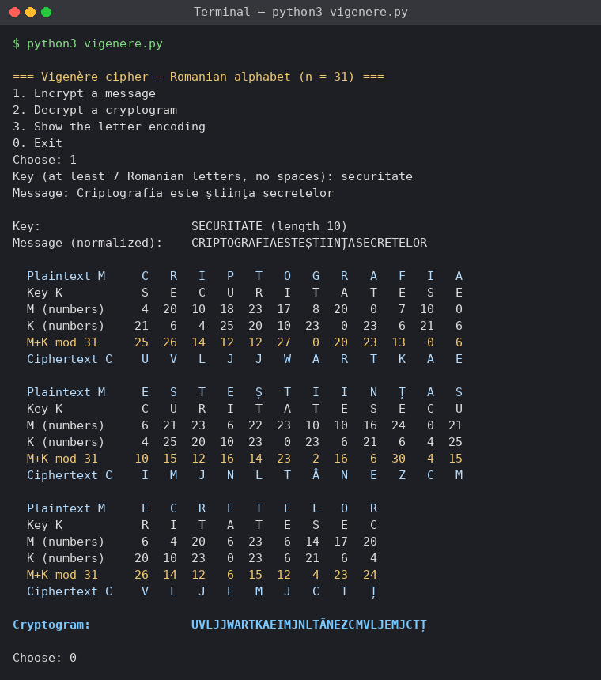
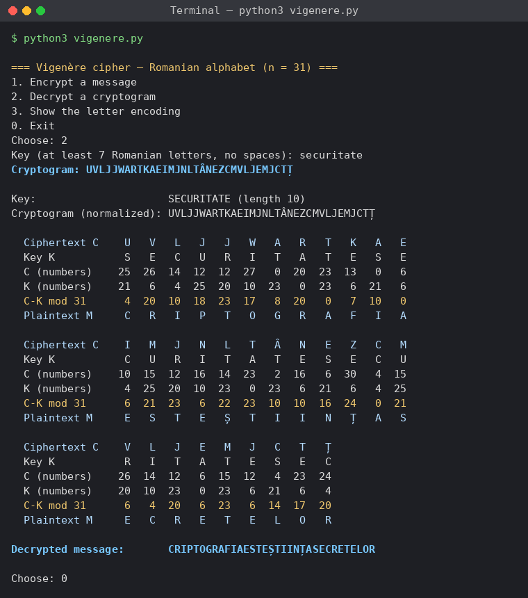
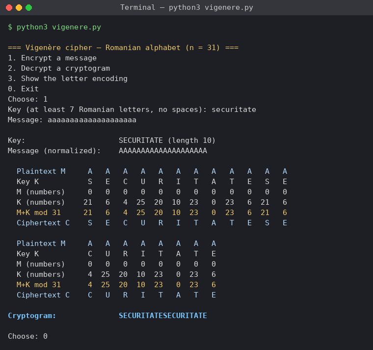
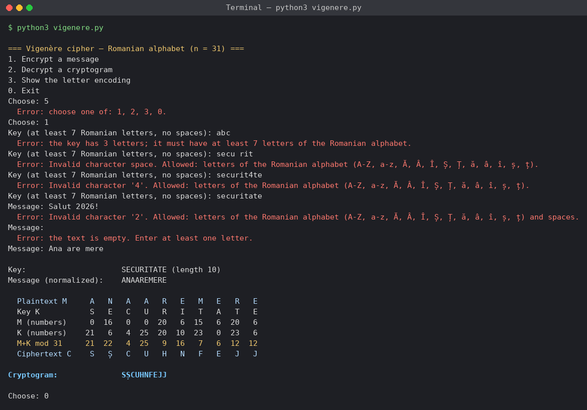
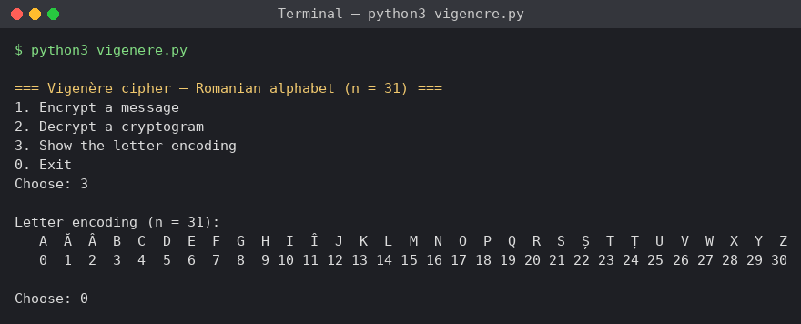

# Report on laboratory work no. 3

**Course:** Cryptography and Security  
**Topic:** Polyalphabetic Ciphers. The Vigenère Cipher (task 3.2)  
**Done by:** st. gr. FAF-243, Buliga Vladislav  
**Checked by:** Zaica Maia, asist. univ.  
Chișinău, 2026

---


## 1 AIM OF THE WORK


### 1.1 Purpose of the laboratory work

The purpose of this laboratory work is to study the polyalphabetic substitution ciphers, which were created to remove the main weakness of the monoalphabetic ciphers, and to implement the Vigenère cipher for the Romanian alphabet of 31 letters. In the second laboratory work a monoalphabetic cipher was broken by frequency analysis, because every letter was always replaced by the same letter. The Vigenère cipher replaces the same letter with different letters at different positions, so the frequencies of the language are flattened and the simple frequency attack no longer works.


### 1.2 Problem statement

**Tasks of the laboratory work (task 3.2):**

- implement the Vigenère cipher for messages in Romanian (31 letters), with the letters encoded by the numbers 0, 1, ..., 30;
- accept only the letters 'A'–'Z' and 'a'–'z' of the Romanian alphabet; for any other character, show the user the correct range of characters;
- the key must have at least 7 letters;
- encrypt and decrypt with the formulas of the mathematical model, c_i = (m_i + k_i) mod 31 and m_i = (c_i − k_i) mod 31;
- remove the spaces from the message first and then convert all letters to uppercase;
- let the user choose the operation, encryption or decryption, enter the key and the message or the cryptogram, and obtain the cryptogram or the decrypted message.

Students with an odd number in the group register solve task 3.1 (Playfair), and those with an even number solve task 3.2 (Vigenère). The author is number 2 in the list, so this report solves task 3.2. The program is written in Python 3 and uses only the standard library.


## 2 THEORETICAL BACKGROUND


### 2.1 Polyalphabetic Substitution

In a monoalphabetic cipher the frequency distribution of the ciphertext is the frequency distribution of the plaintext with the letters renamed, and this is what made the attack of the second laboratory work possible. A cipher is stronger when the distribution of its ciphertext is as flat as possible and gives no information to the cryptanalyst. A polyalphabetic cipher achieves this by using several substitution alphabets: the substitution of a letter changes along the text, depending on its position. A frequent plaintext letter is spread over several ciphertext letters, and every ciphertext letter collects several plaintext letters, frequent and rare ones, so the high and low frequencies are mixed. The first polyalphabetic cipher is attributed to Leon Battista Alberti, who described a cipher disk around 1467.


### 2.2 The Vigenère Cipher

The method known as the Vigenère cipher was first described by Giovan Battista Bellaso in 1553 and was later attributed to Blaise de Vigenère. It uses the same operation as the Caesar cipher, a shift of the letters, but instead of one shift it uses several. The key is a word whose letters give the shifts k_1, k_2, ..., k_L, where L is the length of the key. The key is written repeatedly under the message, so the i-th letter of the message is shifted by the letter of the key that is under it. With the letters encoded as numbers from 0 to n − 1, encryption and decryption are

c_i = (m_i + k_i) mod n,  
m_i = (c_i − k_i) mod n.

For the Romanian alphabet the letters are encoded as A = 0, Ă = 1, Â = 2, B = 3, ..., Z = 30, so n = 31. A Caesar cipher is a Vigenère cipher with a key of length 1. The same computation can be done with the Tabula Recta, a table whose rows are all the n shifts of the alphabet: the ciphertext letter is at the intersection of the row of the key letter and the column of the message letter. For the Romanian alphabet the table has 31 × 31 cells.

The laboratory work gives an example for the English alphabet (n = 26): the message PER ASPERA AD ASTRA with the key SUPER gives the cryptogram HYGEJHYGERVUHXIS. For instance, the first letter P (15) is shifted by S (18): (15 + 18) mod 26 = 7, which is H.


### 2.3 Key Space and Security

The protection given by the multiple shift has two sources. First, the attacker does not know the length of the key. Second, the number of possible keys grows exponentially with the length: for a key of length L over an alphabet of n letters there are n^L keys. For the Romanian alphabet and the minimum length L = 7 there are 31^7 = 27 512 614 111 keys, and for L = 10 there are 31^10 ≈ 8.2 × 10^14.

The cipher is nevertheless not secure by modern standards, because the key repeats. Letters at distance L from each other are encrypted with the same shift, so the text splits into L columns, and each column is a simple Caesar cipher. If the same fragment of plaintext meets the same part of the key, it produces the same fragment of ciphertext; the distances between such repetitions are multiples of the key length (the Kasiski examination, 1863). The index of coincidence of Friedman gives the key length in a statistical way. Once the length is known, each column is broken by frequency analysis, as in the second laboratory work. The cipher is also weak against a known plaintext: a message of only letters A (code 0) gives the key itself as the ciphertext. When the key is random, used only once and as long as the message, the same scheme becomes the one-time pad, which cannot be broken.


### 2.4 Why the Key Must Be Long

A longer key gives more keys to search, but more importantly it gives more columns and fewer letters in every column. With a key of 7 letters and a message of 70 letters, every column has only 10 letters, which is not enough for reliable frequency analysis. The requirement of at least 7 letters makes both the exhaustive search and the frequency attack on the columns harder.


## 3 IMPLEMENTATION

The program is a Python 3 console application with a menu. It reuses the letter encoding and the input validation of the first laboratory work, which used the same Romanian alphabet. A separate file contains automatic tests, including the example of the laboratory work.

*Listing 3.1 – Structure of the project*

```
lab3/
├── vigenere.py        encoding, encryption, decryption, table, menu
├── test_vigenere.py   tests (example of the laboratory work, round trips)
├── screenshots/       results of the program
└── report.md          this report
```

*Listing 3.2 – Running the program and the tests*

```
python3 vigenere.py
python3 test_vigenere.py
```


### 3.1 Letter Encoding and Validation

The alphabet is a list in the order of the encoding, so the code of a letter is its index. CHAR_MAP accepts the uppercase and lowercase letters and maps the variants Ş and Ţ written with a cedilla to the letters Ș and Ț with a comma below. The normalize function removes the spaces, converts every letter to uppercase and rejects any other character with a message that shows the correct range.

*Listing 3.3 – Encoding and normalization*

```
ALPHABET = ["A", "Ă", "Â", "B", "C", "D", "E", "F", "G", "H", "I",
            "Î", "J", "K", "L", "M", "N", "O", "P", "Q", "R", "S",
            "Ș", "T", "Ț", "U", "V", "W", "X", "Y", "Z"]
N = len(ALPHABET)
MIN_KEY_LENGTH = 7


def normalize(text, allow_spaces=True):
    text = unicodedata.normalize("NFC", text)
    result = []
    for ch in text:
        if ch == " " and allow_spaces:
            continue
        if ch not in CHAR_MAP:
            shown = "space" if ch == " " else repr(ch)
            allowed = ALLOWED_TEXT + (" and spaces" if allow_spaces else "")
            raise ValueError(f"Invalid character {shown}. Allowed: {allowed}.")
        result.append(CHAR_MAP[ch])
    return "".join(result)
```

The order required by the laboratory work is respected: the spaces are removed first, and the letters are then converted to uppercase. The key is normalized with allow_spaces=False, because a key with a space would be ambiguous.


### 3.2 Encryption and Decryption

*Listing 3.4 – The Vigenère cipher*

```
def to_numbers(text, alphabet=ALPHABET):
    position = {letter: i for i, letter in enumerate(alphabet)}
    return [position[ch] for ch in text]


def to_letters(numbers, alphabet=ALPHABET):
    return "".join(alphabet[x] for x in numbers)


def extend_key(key, length):
    return (key * (length // len(key) + 1))[:length]


def encrypt(text, key, alphabet=ALPHABET):
    n = len(alphabet)
    m = to_numbers(text, alphabet)
    k = to_numbers(extend_key(key, len(text)), alphabet)
    return to_letters([mod(mi + ki, n) for mi, ki in zip(m, k)], alphabet)


def decrypt(text, key, alphabet=ALPHABET):
    n = len(alphabet)
    c = to_numbers(text, alphabet)
    k = to_numbers(extend_key(key, len(text)), alphabet)
    return to_letters([mod(ci - ki, n) for ci, ki in zip(c, k)], alphabet)
```

The functions follow the mathematical model step by step. to_numbers encodes the letters, and to_letters turns the numbers back into letters. extend_key repeats the key until it is as long as the text and cuts it to that length: the key SECURITATE becomes SECURITATESECURITATESECURITATESEC for a message of 33 letters. encrypt adds the codes of the message and of the key modulo n, and decrypt subtracts them. The mod function returns a value between 0 and n − 1 even for a negative difference, as in the first laboratory work. The alphabet is a parameter, so the same functions work with the English alphabet, which is used in the tests to check the example of the laboratory work.


### 3.3 The Step Table

The function step_table prints the same table as the example of the laboratory work: the text, the repeated key, their codes, the sum or the difference modulo 31, and the result. The table is split into blocks of 12 letters so that it fits in the console. It is printed after every encryption and decryption, so each letter of the result can be checked by hand.


### 3.4 Reading the Input

*Listing 3.5 – Reading the key*

```
def read_key():
    while True:
        raw = input(f"Key (at least {MIN_KEY_LENGTH} Romanian letters, no spaces): ").strip()
        try:
            key = normalize(raw, allow_spaces=False)
        except ValueError as e:
            print(f"  Error: {e}")
            continue
        if len(key) >= MIN_KEY_LENGTH:
            return key
        print(f"  Error: the key has {len(key)} letters; it must have at least {MIN_KEY_LENGTH} "
              f"letters of the Romanian alphabet.")
```

Every input is read in a loop that repeats the question until the value is valid: the menu choice, the key (only Romanian letters, at least 7) and the message or cryptogram (only Romanian letters and spaces, not empty). The main function shows the menu, reads the key and the text, and prints the normalized text, the step table and the result.


## 4 RESULTS


### 4.1 Verification with the Example of the Laboratory Work

The example of the laboratory work uses the English alphabet. Calling the same functions with the English alphabet and the key SUPER reproduces it exactly:

*Listing 4.1 – The example of the laboratory work (n = 26)*

```
  Plaintext M     P   E   R   A   S   P   E   R
  Key K           S   U   P   E   R   S   U   P
  M (numbers)    15   4  17   0  18  15   4  17
  K (numbers)    18  20  15   4  17  18  20  15
  M+K mod 26      7  24   6   4   9   7  24   6
  Ciphertext C    H   Y   G   E   J   H   Y   G

  Plaintext M     A   A   D   A   S   T   R   A
  Key K           E   R   S   U   P   E   R   S
  M (numbers)     0   0   3   0  18  19  17   0
  K (numbers)     4  17  18  20  15   4  17  18
  M+K mod 26      4  17  21  20   7  23   8  18
  Ciphertext C    E   R   V   U   H   X   I   S
```

The result HYGEJHYGERVUHXIS is the same as in the laboratory work, and the tests in test_vigenere.py check it automatically, together with the Romanian example below, the wrap-around (Z shifted by Ă gives A, because (30 + 1) mod 31 = 0) and 1000 random messages that must decrypt back to themselves.

*Listing 4.2 – Running the tests*

```
test_example_from_the_laboratory_work: passed
test_romanian_example: passed
test_wrap_around: passed
test_random_round_trips: passed
```


### 4.2 Encryption and Decryption in Romanian

The message "Criptografia este ştiinţa secretelor", typed with the cedilla letters ş and ţ, was encrypted with the key "securitate" of 10 letters. The program removed the spaces, converted the letters to uppercase, replaced ş and ţ with Ș and Ț, and printed the step table (figure 4.1). The cryptogram is UVLJJWARTKAEIMJNLTÂNEZCMVLJEMJCTȚ. It can be checked by hand on the first letter: C (4) + S (21) = 25, which is U; on the 12th letter A (0) + E (6) = 6, which is E; and on the 22nd letter Ț (24) + E (6) = 30, which is Z. Decryption with the same key gives back CRIPTOGRAFIAESTEȘTIINȚASECRETELOR (figure 4.2), and the final spaces are added manually: "criptografia este știința secretelor".



*Figure 4.1 – Encryption with the key SECURITATE*



*Figure 4.2 – Decryption with the same key*

The example shows the effect of the polyalphabetic substitution. The letter E appears 5 times in the message and is encrypted as five different letters: E, I, J, N and V. In the other direction, the ciphertext letter J, the most frequent in the cryptogram, comes from E, P, R and twice from T. A monoalphabetic cipher would have encrypted every E with the same letter.


### 4.3 A Message of Repeated Letters

The message "aaaaaaaaaaaaaaaaaaaa" was encrypted with the same key (figure 4.3). In a monoalphabetic cipher the result would be one letter repeated 20 times. Here it is SECURITATESECURITATE: the same letter is encrypted with 10 different shifts. Because A has the code 0, (0 + k_i) mod 31 = k_i, so the cryptogram is the key itself, repeated. This shows two properties at once: the period of the cipher is the length of the key, and a known plaintext reveals the key immediately.



*Figure 4.3 – A message made of the same letter*


### 4.4 Invalid Input

The program was given invalid values (figure 4.4): the menu choice 5, the key "abc" (only 3 letters), the key "secu rit" (a space), the key "securit4te" (a digit), the message "Salut 2026!" (digits and punctuation) and a message made only of spaces. Each time it explained the error, showed the allowed range and asked again; the message "Ana are mere" was then accepted. Option 3 of the menu shows the encoding of the 31 letters (figure 4.5).



*Figure 4.4 – Invalid input*



*Figure 4.5 – The letter encoding (option 3)*

*Table 4.1 – Comparison of the ciphers of laboratory works 1–3*

| Cipher | Key | Number of keys (Romanian alphabet) | Main attack |
|---|---|---|---|
| Caesar | one shift | 30 | exhaustive search |
| Caesar with a permutation | shift and keyword | at most 31! × 30 | frequency analysis |
| Vigenère | word of L ≥ 7 letters | 31^L (31^7 ≈ 2.75 × 10^10) | key length (Kasiski, Friedman), then frequency analysis per column |


## CONCLUSION

In this laboratory work I implemented the Vigenère cipher for the Romanian alphabet of 31 letters, following the formulas c_i = (m_i + k_i) mod 31 and m_i = (c_i − k_i) mod 31. The program validates the key and the text, removes the spaces, converts the letters to uppercase and prints a table with all the intermediate values, so every letter of the result can be checked by hand. The same functions, called with the English alphabet, reproduce the example of the laboratory work exactly.

The Vigenère cipher is a sequence of Caesar ciphers, one for every letter of the key. The results showed the main difference from the monoalphabetic ciphers of the first two works: the letter E of the message was encrypted as five different letters, and a message of twenty A's gave twenty letters following the key instead of one repeated letter. The frequency analysis of the second laboratory work cannot be applied to the whole cryptogram in this way.

The cipher still has a weakness: the key repeats with a period equal to its length. The message of repeated A's made this visible, and it also showed that a known plaintext reveals the key. Once the length of the key is found, for example with the Kasiski examination, the cryptogram splits into Caesar ciphers that are easy to break. A longer key, such as the required minimum of 7 letters, makes the attack harder, and a random key as long as the message, used only once, would remove this weakness completely.


## SOURCE CODE

The full source code is available in the GitHub repository https://github.com/lbrty-7/cs-2026-BuligaVladislav, on the branch lab3 (folder lab3).


## REFERENCES

1. Laboratory Work No. 3. Polyalphabetic Ciphers. Cryptography and Security, FCIM, UTM, 2026.

2. Kahn, D. The Codebreakers: The Story of Secret Writing. Macmillan, 1967. Chapter 4 "The Rise of the West".

3. Singh, S. The Code Book. Fourth Estate, 1999. Chapter 2 "Le Chiffre Indéchiffrable".

4. Stallings, W. Cryptography and Network Security: Principles and Practice. 7th ed. Pearson, 2017. Chapter 3 "Classical Encryption Techniques".
